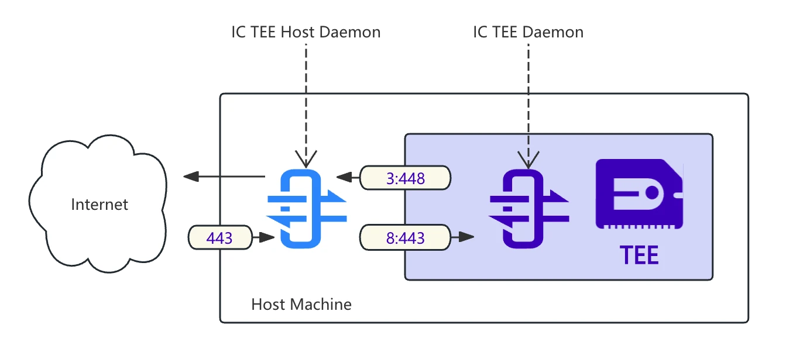

# IC TEE Host Daemon

`ic_tee_host_daemon` is a daemon running on the host machine of an enclave, providing the following functions:

1. Forwards requests from the enclave to the internet.
2. Listens for requests from the internet and forwards them to the enclave.
3. Receives logs from the enclave and outputs them to stdout.



## Usage

```bash
sudo ./ic_tee_host_daemon --outbound-vsock-addr 3:448 --inbound-vsock-addr 8:443 --inbound-listen-addr 0.0.0.0:443 --logtail-addr 127.0.0.1:9999
```

or with default values:
```bash
sudo ./ic_tee_host_daemon
```

## License
Copyright © 2024-2025 [LDC Labs](https://github.com/ldclabs).

This project is dual-licensed under the [MIT License](../../LICENSE-MIT) and [Apache License, Version 2.0](../../LICENSE-APACHE). You may use either license.
