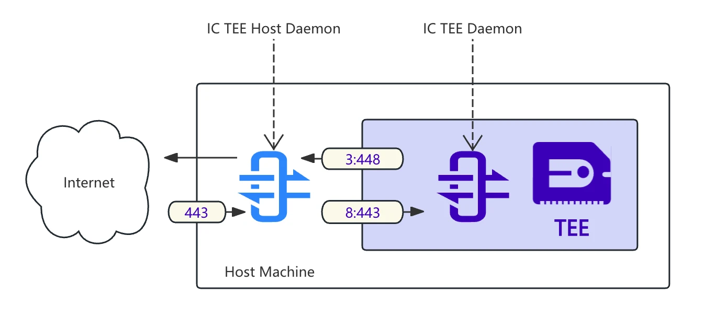

# `ic_tee_nitro_gateway`
## Overview

`ic_tee_nitro_gateway` is a gateway service within an AWS Nitro enclave. It is launched inside the enclave through the ICP `ic_tee_identity` identity service and the IC-COSE configuration service, then forwards requests to the business application running in the enclave.

The bootstrap process is as follows:

1. **Generate attestation** for sign in, obtaining an identity via the ICP `ic_tee_identity` service to access other services on ICP. `ic_tee_identity` verifies the attestation and derives an identity, generating the same identity for identical enclave images.

2. **Optionally switch to a fixed identity** by requesting a delegation from IC-COSE. This keeps the gateway principal stable across application upgrades.

3. **Start the web service** after reading the root secret and TLS configuration from IC-COSE. The gateway uses port 8443 inside the enclave and forwards requests to the configured application port.

## Deploy
### Building and running AWS Nitro Enclave image

#### Run `ic_tee_host_daemon` on host machine



`ic_tee_host_daemon` is a daemon running on the host machine of an enclave, providing the following functions:

1. Forwards requests from the enclave to the internet.
2. Listens for requests from the internet and forwards them to the enclave.
3. Receives logs from the enclave and outputs them to stdout.

```bash
sudo nohup ./ic_tee_host_daemon > tee.log 2>&1 &
```

See the [host daemon README](../ic_tee_host_daemon/README.md) for listener and VSOCK settings.

#### Build and run enclave

The following steps should be run in AWS Nitro-based instances.

https://docs.aws.amazon.com/enclaves/latest/user/getting-started.html

Set the gateway options in [supervisord.conf](../../nitro_enclave/supervisord.conf) before building. Set `--origin` to the public HTTPS URL and add `--upstream-port` if the gateway should forward requests to an application in the enclave.

Build the enclave image and record the PCR0 printed by `nitro-cli`.
```bash
sudo docker build --platform linux/amd64 -f nitro_enclave/amd64.Dockerfile -t ic-tee-enclave .
sudo nitro-cli build-enclave --docker-uri ic-tee-enclave --output-file ic_tee_nitro_gateway_enclave_amd64.eif
```

For `--id-scope image`, derive the enclave principal from the PCR0 and the configured identity canister ID.
```bash
cargo install ic_tee_cli
ic_tee_cli -c "$IDENTITY_CANISTER_ID" identity-derive --seed "$PCR0"
```

With `--cose-identity-name` configured, use a namespace manager identity to add the derived enclave principal as a delegator for the named fixed identity.
```bash
dfx canister call "$COSE_CANISTER_ID" namespace_add_delegator \
  "(record { ns = \"$COSE_NAMESPACE\"; name = \"$COSE_IDENTITY_NAME\"; delegators = vec { principal \"$ENCLAVE_PRINCIPAL\" } })" --ic
dfx canister call "$COSE_CANISTER_ID" namespace_get_fixed_identity \
  "(\"$COSE_NAMESPACE\", \"$COSE_IDENTITY_NAME\")" --ic
```

Save the TLS certificate and key in the gateway's namespace. Use the fixed principal as the subject when a fixed identity is configured, or the enclave principal otherwise.
```bash
ic_tee_cli --ic -i "$MANAGER_PEM" -c "$COSE_CANISTER_ID" setting-save-tls \
  --ns "$COSE_NAMESPACE" --subject "$GATEWAY_PRINCIPAL" --cert-file "$CERT_PEM" --key-file "$KEY_PEM"
```

Run the enclave.
```bash
sudo nitro-cli run-enclave --cpu-count 2 --memory 512 --enclave-cid 8 --eif-path ic_tee_nitro_gateway_enclave_amd64.eif
# Start allocating memory...
# Started enclave with enclave-cid: 8, memory: 512 MiB, cpu-ids: [1, 3]
# {
#   "EnclaveName": "ic_tee_nitro_gateway_enclave_amd64",
#   "EnclaveID": "i-056e1ab9a31cd77a0-enc19306ae0f2d054b",
#   "ProcessID": 18178,
#   "EnclaveCID": 8,
#   "NumberOfCPUs": 2,
#   "CPUIDs": [
#     1,
#     3
#   ],
#   "MemoryMiB": 512
# }
```

Stop the enclave.
```bash
sudo nitro-cli describe-enclaves
sudo nitro-cli terminate-enclave --enclave-id i-056e1ab9a31cd77a0-enc19306ae0f2d054b
```

## License
Copyright © 2024-2025 [LDC Labs](https://github.com/ldclabs).

This project is dual-licensed under the [MIT License](../../LICENSE-MIT) and [Apache License, Version 2.0](../../LICENSE-APACHE). You may use either license.
